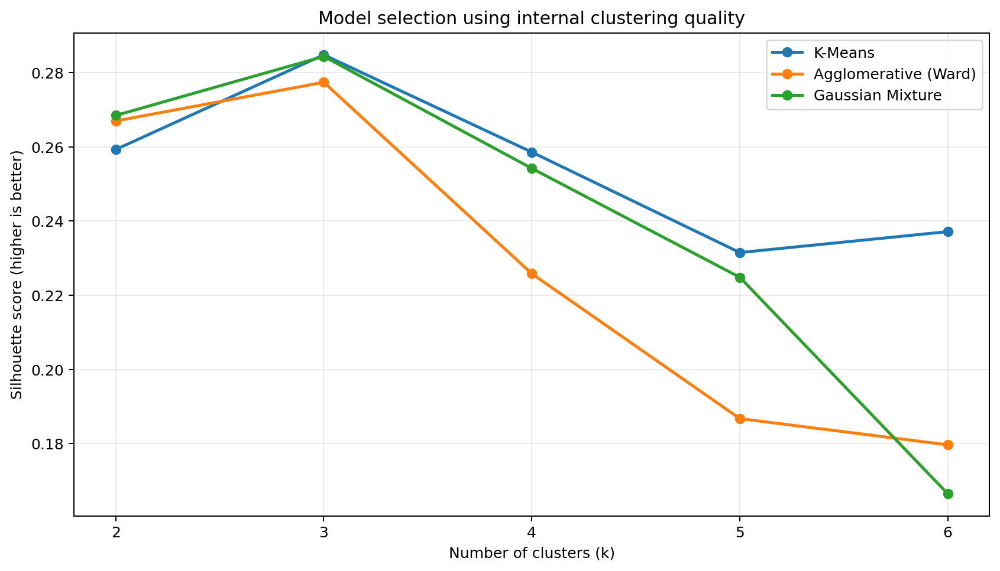
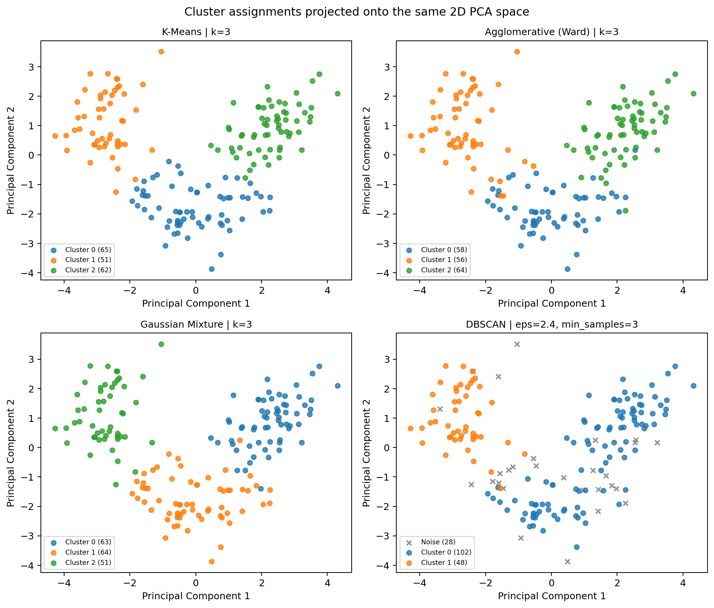
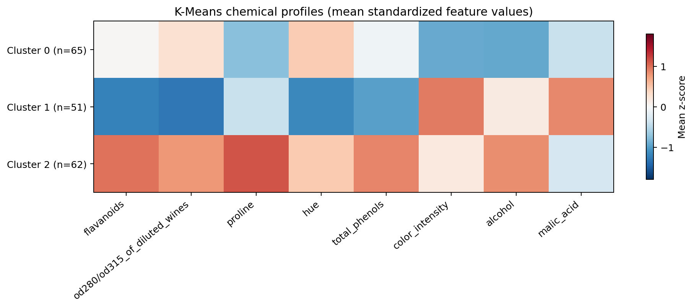
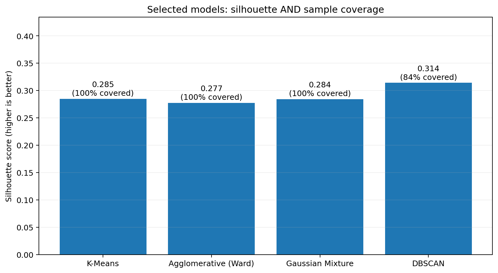

# Practical 06 — Clustering Algorithms

Comparing four unsupervised learning algorithms on real wine chemistry data as part of TY B.Tech. Artificial Intelligence and Machine Learning at MIT Academy of Engineering (2026–27).

## Project objective

Identify meaningful groups in **178 wine samples described by 13 numerical chemical measurements**, without using cultivar labels to train or select the clustering models. Compare K-Means, hierarchical agglomerative clustering (Ward linkage), Gaussian Mixture Models (GMM), and DBSCAN using internal clustering-quality metrics and carefully interpret noise handling.

## How the experiment works

- Load the real-world Wine Recognition dataset using `sklearn.datasets.load_wine()` (original UCI dataset).
- Confirm 178 rows, 13 measured features, and no missing values.
- Standardize **all 13 features** with `StandardScaler` so measurements with larger units do not dominate Euclidean-distance algorithms.
- For K-Means, Ward, and GMM, evaluate **k = 2 through 6**, choosing the highest silhouette score within each algorithm. We compare all samples using the same standardized feature space.
- For DBSCAN, search epsilon = 1.8–3.5 and `min_samples` from 3, 4, 5, 6, and 8. Require at least **75% non-noise coverage** and rank viable parameter choices by `silhouette × coverage`.
- Report silhouette, Davies–Bouldin, Calinski–Harabasz, coverage, noise count, and cluster sizes. Evaluate DBSCAN's silhouette **only on assigned samples**, clearly distinguishing it from full-data comparisons.
- Use original cultivar labels **only after the unsupervised procedure** as an optional external diagnostic with Adjusted Rand Index (ARI). Reference labels have no role in data scaling, fitting, model selection, or PCA.
- PCA is used for a 2D plot only; clustering and main metrics use all 13 standardized features.

## Verified results

Execution environment: Python 3, scikit-learn 1.8.0; random seed 42 for applicable algorithms.

| Algorithm | Chosen parameters | Clusters | Coverage | Silhouette ↑ | Davies–Bouldin ↓ | Calinski–Harabasz ↑ | ARI (post-hoc) |
|:--|:--|--:|--:|--:|--:|--:|--:|
| **K-Means** | **k = 3** | 3 | **100%** | **0.2849** | **1.3892** | **70.9400** | **0.8975** |
| Agglomerative (Ward) | k = 3 | 3 | 100% | 0.2774 | 1.4186 | 67.6475 | 0.7899 |
| Gaussian Mixture | k = 3 | 3 | 100% | 0.2844 | 1.3938 | 70.6878 | 0.8804 |
| DBSCAN | eps = 2.4, min_samples = 3 | 2 | **84.27%** | 0.3142* | 1.2519* | 72.4176* | 0.4171 |

\*DBSCAN's internal scores are computed on its **150 non-noise samples**, excluding **28 noise points**. They must not be ranked against full-coverage model metrics as though they measured the same population.

**Conclusion:** K-Means (k = 3) is the best complete-data grouping in this particular experiment. GMM is a close alternative (silhouette difference 0.0005); the small margin is not proof of universal superiority. DBSCAN finds a density-based 2-cluster structure while rejecting around 16% of observations.

### Cluster interpretation

K-Means forms clusters with 65, 51, and 62 wine samples. Standardized feature averages suggest distinct chemical profiles:

- **Cluster 0:** lower alcohol, color intensity, and proline.
- **Cluster 1:** higher color intensity and malic acid, with low flavanoids and hue.
- **Cluster 2:** higher alcohol, flavanoids, total phenols, and proline.

Cluster IDs are arbitrary; a second run or another library may permute IDs without changing the underlying partition.

## Visualizations

All plots are generated from the actual experimental assignments, not synthetic diagrams.









**PCA visualization limitation:** The first two principal components account for approximately 55.41% of standardized feature variance. The 2D plot is illustrative and does not replace the 13D numerical evaluation.

## Repository structure

```text
.
├── clustering_models.py                   # Full reproducible experiment
├── clustering_models.ipynb                # Step-by-step lab notebook
├── requirements.txt                       # Python dependencies
├── README.md                              # Experimental methodology and findings
├── .gitignore
├── tests/
│   └── test_clustering.py                 # Reproducibility and validity checks
└── results/
    ├── console_output.txt
    ├── experiment_summary.json
    ├── model_comparison.csv
    ├── parameter_search.csv
    ├── cluster_assignments.csv
    ├── kmeans_standardized_profiles.csv
    ├── silhouette_by_k.png / .svg
    ├── cluster_pca_comparison.png / .svg
    ├── kmeans_cluster_profiles.png / .svg
    └── selected_model_comparison.png / .svg
```

## Run locally

Python 3.11+ is recommended. On macOS/Linux:

```bash
python3 -m venv .venv
source .venv/bin/activate
python -m pip install -r requirements.txt
python clustering_models.py
pytest -q
jupyter lab
```

On Windows, activate the venv using `.venv\\Scripts\\activate`, then use the same other commands.

The script recreates CSV, JSON, SVG, and PNG artifacts in `results/`. Open `clustering_models.ipynb` to execute the experiment step by step and inspect visualizations interactively.

## Metrics and interpretation

- **Silhouette:** balances within-group compactness and between-group separation; higher is better.
- **Davies–Bouldin index:** lower is better; measures within-cluster scatter relative to separation.
- **Calinski–Harabasz index:** higher is better; compares between- and within-group dispersion.
- **Coverage/noise:** crucial when DBSCAN leaves observations unassigned.
- **Adjusted Rand Index:** external diagnostic only, using labels not employed in the unsupervised analysis.

The real-world performance of clustering algorithms depends on the dataset, feature construction, scaling, parameters, cluster geometry, and treatment of outliers. Internal scores cannot establish whether the clusters are causally meaningful or suitable for downstream decisions.

## Limitations and responsible use

This is a small educational dataset, with no longitudinal replication, cluster stability assessment, or out-of-sample validation. PCA reduces 13D chemistry to a plot containing only about 55.41% of variance. DBSCAN scores exclude noise, so coverage must be considered. Cultivar labels are available but used only for *post hoc* analysis. No inference should be made about wine price, safety, authenticity, personal characteristics, or product quality without domain validation.

## Dataset credit

Original **Wine Recognition** data from the UCI Machine Learning Repository, distributed in scikit-learn as `load_wine`. See https://scikit-learn.org/stable/modules/generated/sklearn.datasets.load_wine.html and https://archive.ics.uci.edu/dataset/109/wine.

## License / academic use

The code is provided for an academic practical assignment. Dataset attribution is maintained; model outputs are for educational analysis only.